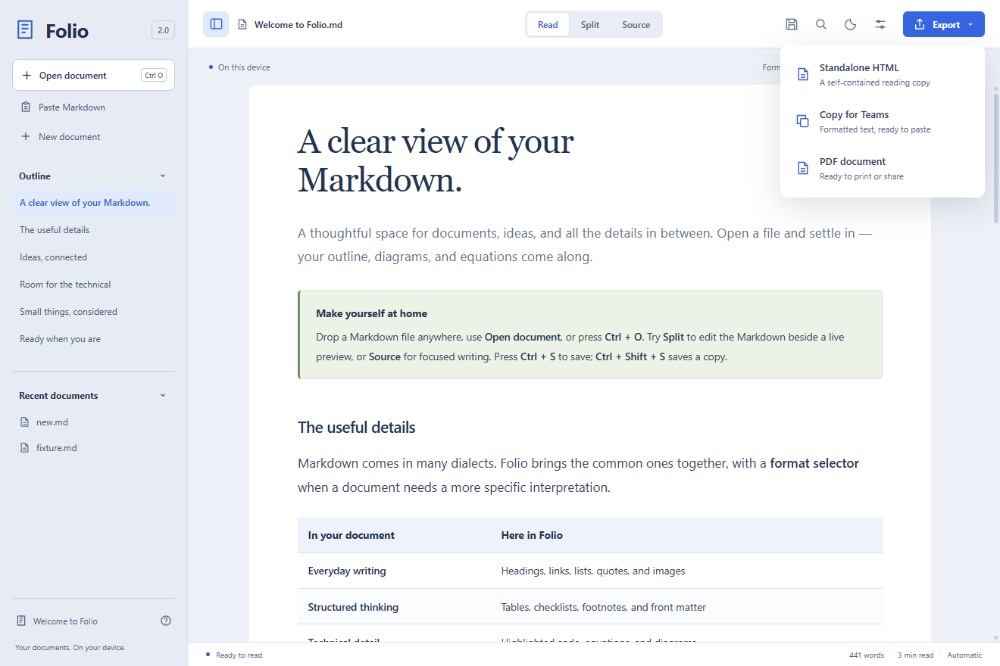

# Copy Markdown into Microsoft Teams

Open or paste a Markdown document in Folio, then choose **Export → Copy for Teams** (also available in **File → Copy for Teams**). Switch to the Teams desktop or web message composer and paste with **Ctrl+V**. Review the draft before sending. Ctrl+Shift+V forces plain text and removes formatting.

Folio copies the entire current draft, including unsaved edits, using the selected Markdown interpretation and line-break preference. It does not save the document, contact Teams, upload anything, or send a message. No image downloads or external conversion services are involved.

## Why formatted clipboard content

Teams uses Markdown-style typing shortcuts rather than a standard Markdown document importer. Folio converts the document to conservative HTML on the Windows clipboard, alongside a readable plain-text fallback. Pasting receives formatting instead of raw Markdown punctuation. This is for the message composer, not Adaptive Cards, bots, webhooks, or Microsoft Graph payloads.

## Conversion behavior

| Markdown content | Clipboard output |
| --- | --- |
| Bold, italic, strikethrough, underline | Semantic rich-text formatting |
| Headings | Heading levels 1–3; deeper headings become bold paragraphs; Teams chooses their appearance |
| Web and email links | Clickable links; plain-text fallback includes the destination |
| Bullets and numbered lists | Semantic lists, including nesting and starting numbers |
| Task lists | Visible checked/unchecked Unicode markers |
| Quotes | Block quotes |
| Inline and fenced code | Inline/preformatted text, preserving literal punctuation and indentation; Teams controls code-block presentation |
| Tables | Labeled rows and cells, preserving empty cells and readable content without relying on table layout |
| Math | TeX source in code formatting |
| Mermaid and Graphviz | Diagram source in preformatted text |
| Folded callouts | Title and full body, expanded |
| Footnotes | Reference labels and footnote text; internal return links are removed |
| Images | Descriptive links for public HTTP(S) URLs, otherwise labels; attach local images separately |
| Local links and document anchors | Labels without private destination paths or broken links |
| Front matter | Omitted as document metadata, with a conversion note |
| Custom styling and other media | Simplified formatting or descriptive text labels |

After copying, **Document details → Last Teams copy** explains conversions that occurred. That section refers to the last copy, not edits made afterward. HTML/PDF export remains the option for sharing a full visual document with drawings, formulas and embedded images.

## Size and compatibility boundaries

Folio rejects output over an 80 KB budget, measured conservatively as the larger of UTF-8 and UTF-16 sizes for either clipboard representation. Nothing is silently truncated or partially copied. For a long document, copy a shorter section into a new Folio document, or share an HTML/PDF export. Teams adds its own metadata, and tenant/client behavior can still impose further limits.

This feature was checked in a real Windows Teams desktop composer on 27 October 2026 using [the synthetic fixture](../samples/teams.md). Formatting, lists, quotes, row fallbacks, code, formula source, diagram source, folded content, image labels and the ending marker were visually verified. The draft was not sent, and the test paste was undone.

That verifies the tested desktop paste path, not every Teams client or message type. Web/mobile, sent-message rendering, native code-language selection, and tenant-specific policies are not certified. No claim of universal 100% fidelity is made.

## Primary references

- [Microsoft: Teams Markdown-style typing shortcuts](https://support.microsoft.com/en-gb/teams/chat/use-markdown-formatting-in-microsoft-teams)
- [Microsoft: formatting messages](https://support.microsoft.com/en-us/teams/chat/format-a-message-in-microsoft-teams)
- [Microsoft: Teams message limits](https://learn.microsoft.com/en-us/microsoftteams/limits-specifications-teams)
- [Microsoft: HTML clipboard format](https://learn.microsoft.com/en-us/windows/win32/dataxchg/html-clipboard-format)
