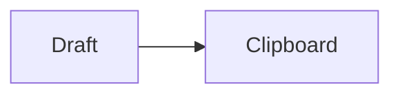

# Folio Teams formatting check

Synthetic test only. **Bold**, *italic*, ~~struck out~~, `inline code`, and [Example link](https://example.com).

## Lists and quotation

- First bullet
- Second bullet
  - Nested bullet

3. Third item
4. Fourth item

- [x] Completed task
- [ ] Pending task

> Quoted sample text.

## Table fallback

| Item | Status |
| --- | --- |
| Café 你好 | Ready |
| Empty cell | |

## Code and math

```javascript
const value = "<safe>";
  // indentation stays
```

Formula: $E=mc^2$.



> [!note]- Folded note
> This body is included in the copy.


End of synthetic test. Nothing needs to be sent.
